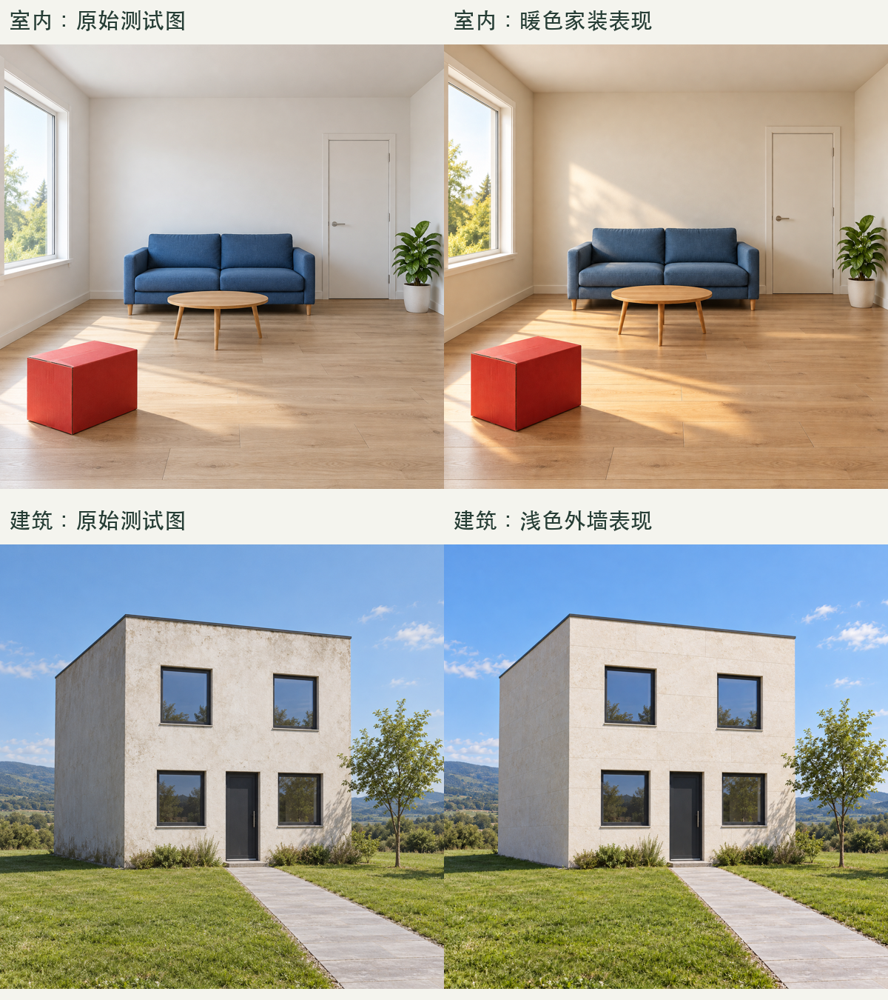

# Design Render Skills · 用 Codex 做设计出图

36个功能 Skills，加1个工作台，覆盖室内、建筑、景观、鸟瞰、彩平、家具场景、图片处理和图像辅助建模。

功能分类参考 Evai 的43个公开目录条目，执行由 Codex 与使用者环境中的工具完成。这是一套独立整理的工作流，不代表 Evai 官方实现或服务效果。

## 已验证到哪里

2026-10-28，36个功能各执行一个受控样本：**17项样本通过、17项部分通过、2项未通过**。本地图片脚本11项行为测试通过。样本通过不代表全部分支通过；未取得网站同输入生成结果，效果等价性尚未验证。

扩图、空房装修的画幅与结构保留仍有问题；家具和抠图存在细节缺口；放大样本仅为LANCZOS插值，三维样本仅为粗略参数化GLB。原始生成、补救合成和失败样本均保留在测试资料中。

- [实践文章：用 Codex 做设计出图，37 个 Skills 实践](docs/37-skills-practice.md)
- [逐功能测试结论](docs/validation/测试报告.md)
- [图文报告 HTML（下载仓库后在浏览器打开）](docs/validation/测试报告.html)



## 安装

```bash
git clone https://github.com/liuqing0224/design-render-skills.git
cd design-render-skills
python3 install.py
python3 install.py --check
```

默认安装到`$CODEX_HOME/skills`；未设置`CODEX_HOME`时使用`~/.codex/skills`。遇到任一同名目标，安装器会在写入前停止。可用`--target <目录>`指定位置；`--check`只核对安装副本。

生成与编辑需要环境中实际可用且获授权的图像工具；这些文件不会提供模型服务或转移原机器的授权。执行本地放大、压缩与转线稿脚本前，安装Pillow：

```bash
python3 -m pip install -r requirements.txt
python3 tests/test_image_ops.py
```

## 使用

安装后，在新会话中调用具体Skill，或从工作台开始：

```text
使用 $evai-design-workbench，处理这张客厅图。
只把指定墙面换成深灰石材，保留家具、门窗和相机。
指定区域外像素不变，输出另存PNG并检查差异和接缝。
```

```text
使用 $evai-siteplan-colorize，为总平分区上色。
区分建筑、道路、绿地和水体，保留建筑轮廓、路网和标注。
```

```text
使用 $evai-image-compress，无损压缩这些PNG。
尺寸和透明通道不变，报告前后字节数与像素核验结果。
```

## 功能索引

| 功能 | 调用名称 | 文件 |
|---|---|---|
| AI模型渲染 | `$evai-model-render` | [SKILL.md](skills/evai-model-render/SKILL.md) |
| 家装渲染 | `$evai-home-render` | [SKILL.md](skills/evai-home-render/SKILL.md) |
| 工装渲染 | `$evai-commercial-render` | [SKILL.md](skills/evai-commercial-render/SKILL.md) |
| AI洗图与图像细节提升 | `$evai-image-enhance` | [SKILL.md](skills/evai-image-enhance/SKILL.md) |
| 软装硬装替换 | `$evai-replace-interior-elements` | [SKILL.md](skills/evai-replace-interior-elements/SKILL.md) |
| 室内局部渲染 | `$evai-interior-local-edit` | [SKILL.md](skills/evai-interior-local-edit/SKILL.md) |
| AI材质替换 | `$evai-material-replace` | [SKILL.md](skills/evai-material-replace/SKILL.md) |
| 文生图 | `$evai-text-to-image` | [SKILL.md](skills/evai-text-to-image/SKILL.md) |
| 室内风格迁移 | `$evai-interior-style-transfer` | [SKILL.md](skills/evai-interior-style-transfer/SKILL.md) |
| 一键彩平图 | `$evai-floorplan-colorize` | [SKILL.md](skills/evai-floorplan-colorize/SKILL.md) |
| 毛坯装修 | `$evai-empty-room-furnish` | [SKILL.md](skills/evai-empty-room-furnish/SKILL.md) |
| 建筑渲染 | `$evai-building-render` | [SKILL.md](skills/evai-building-render/SKILL.md) |
| 室外局部渲染 | `$evai-exterior-local-edit` | [SKILL.md](skills/evai-exterior-local-edit/SKILL.md) |
| 人物模特添加 | `$evai-add-people` | [SKILL.md](skills/evai-add-people/SKILL.md) |
| AI环境替换 | `$evai-environment-replace` | [SKILL.md](skills/evai-environment-replace/SKILL.md) |
| AI旧房改造 | `$evai-facade-renovation` | [SKILL.md](skills/evai-facade-renovation/SKILL.md) |
| 室外风格迁移 | `$evai-exterior-style-transfer` | [SKILL.md](skills/evai-exterior-style-transfer/SKILL.md) |
| 大鸟瞰渲染 | `$evai-aerial-render` | [SKILL.md](skills/evai-aerial-render/SKILL.md) |
| 总彩平渲染 | `$evai-siteplan-colorize` | [SKILL.md](skills/evai-siteplan-colorize/SKILL.md) |
| 景观渲染 | `$evai-landscape-render` | [SKILL.md](skills/evai-landscape-render/SKILL.md) |
| AI视角转换 | `$evai-viewpoint-change` | [SKILL.md](skills/evai-viewpoint-change/SKILL.md) |
| 氛围转换 | `$evai-atmosphere-change` | [SKILL.md](skills/evai-atmosphere-change/SKILL.md) |
| 建筑万物迁移 | `$evai-exterior-object-transfer` | [SKILL.md](skills/evai-exterior-object-transfer/SKILL.md) |
| 室内AI棚拍 | `$evai-furniture-studio` | [SKILL.md](skills/evai-furniture-studio/SKILL.md) |
| 室外AI场景 | `$evai-furniture-outdoor` | [SKILL.md](skills/evai-furniture-outdoor/SKILL.md) |
| 家具替换 | `$evai-furniture-replace` | [SKILL.md](skills/evai-furniture-replace/SKILL.md) |
| 一键抠图 | `$evai-image-cutout` | [SKILL.md](skills/evai-image-cutout/SKILL.md) |
| 拼图美化 | `$evai-collage-beautify` | [SKILL.md](skills/evai-collage-beautify/SKILL.md) |
| AI图转3D | `$evai-image-to-3d` | [SKILL.md](skills/evai-image-to-3d/SKILL.md) |
| 图片转提示词 | `$evai-image-to-prompt` | [SKILL.md](skills/evai-image-to-prompt/SKILL.md) |
| 提示词扩词 | `$evai-prompt-expand` | [SKILL.md](skills/evai-prompt-expand/SKILL.md) |
| 清晰度放大 | `$evai-image-upscale` | [SKILL.md](skills/evai-image-upscale/SKILL.md) |
| 无损压缩 | `$evai-image-compress` | [SKILL.md](skills/evai-image-compress/SKILL.md) |
| 智能扩图 | `$evai-image-outpaint` | [SKILL.md](skills/evai-image-outpaint/SKILL.md) |
| 图片转线稿 | `$evai-image-to-lineart` | [SKILL.md](skills/evai-image-to-lineart/SKILL.md) |
| 物体移除 | `$evai-object-remove` | [SKILL.md](skills/evai-object-remove/SKILL.md) |

调度入口：[设计表现工作台](skills/evai-design-workbench/SKILL.md)。


## 发布副本说明

公开版把原机器专用的图像工具替代命令改为条件式说明；原37个Skill标识、功能流程及脚本保持。原始素材为测试生成或人工绘制，不含真实客户项目。发布副本的安装器和本地脚本已单独验证；没有重新生成整套图像来声称更新了效果结论。
