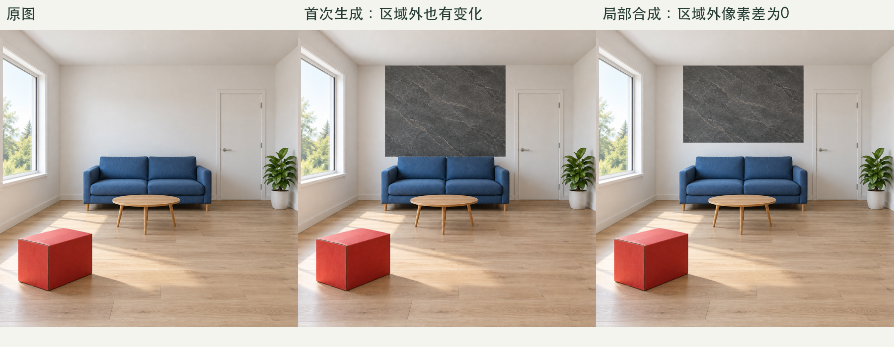
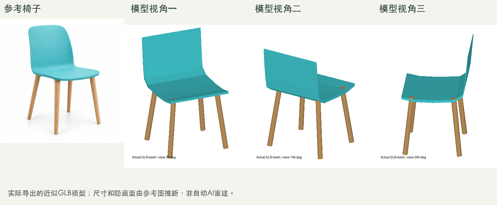

# 用 Codex 做设计出图：37 个 Skills 实践

我整理了一套由 Codex 直接执行的室内外设计表现 Skills：36 个功能技能，加 1 个调度技能，覆盖家装、工装、建筑、景观、鸟瞰、彩平、家具场景、图片处理和图像辅助建模。

功能分类参考了 Evai 的公开目录。我把其中 43 个分类条目去重、拆分，再为每个技能补上必要输入、修改范围、执行步骤、交付和验收要求。网站用于提供功能线索，具体任务交给 Codex 和当前环境可用的工具执行。

整理完以后，我又按 36 个功能的主要路线，各做了一个受控样本。2026 年 10 月 28 日这轮测试的结果是：17 项样本通过、17 项部分通过、2 项未通过。

这些结果让我把几件事区分开来：功能名称是否覆盖、工作流能否执行、图像是否满足保留条件，以及输出是否与网站效果一致。最后一项还没有完成同素材对照，不能据此宣称已经复现网站的能力。


*图1｜本轮合成测试素材的前后对照。上排是暖色家装表现，下排是浅色外墙表现；图片用于展示视觉变化，未验证工程尺寸。*

拆技能时，我先把“把这张图做得好看一点”展开成了几个具体问题：原图是照片、白模截图，还是线稿？要改的是材质、家具、光照，还是整个风格？哪些门窗和物件必须保留？参考图提供的是产品身份，还是色彩与氛围？最后交付一张图、透明素材，还是可以打开的三维模型？

这些问题会影响工具选择和执行顺序。只改墙面，需要定位编辑区域；替换家具，需要核对参考款式；改变视角，需要先判断有没有真实模型；减小文件体积，则要先确认能否改变像素和尺寸。

我据此整理了下面 37 个技能。完全重复的功能跨分类共用一个技能；家具替换、室内软硬装替换和室外物体迁移虽然相近，但输入对象和验收重点不同，分别保留。

| Skill | 负责的工作 |
|---|---|
| `evai-design-workbench` | 调度入口，选择技能并组织多步骤任务 |
| `evai-model-render` | 根据模型或截图改善渲染表现，核对材质和结构 |
| `evai-home-render` | 客厅、卧室等住宅空间的效果表现 |
| `evai-commercial-render` | 办公、餐饮、零售等商业空间的效果表现 |
| `evai-image-enhance` | 改善噪点、发灰和材质细节表现 |
| `evai-replace-interior-elements` | 按清单替换室内软装、硬装外观 |
| `evai-interior-local-edit` | 室内指定区域的重绘与修补 |
| `evai-material-replace` | 更换指定物体或表面的材质 |
| `evai-text-to-image` | 根据文字生成设计意向图 |
| `evai-interior-style-transfer` | 调整室内风格，核对空间和家具锚点 |
| `evai-floorplan-colorize` | 为室内平面分区填色，保留线稿和文字 |
| `evai-empty-room-furnish` | 在空房或毛坯空间图中加入装修与家具 |
| `evai-building-render` | 建筑外观渲染，核对体量、层数和开口 |
| `evai-exterior-local-edit` | 建筑、景观效果图的局部修改 |
| `evai-add-people` | 按位置、数量、姿态要求添加人物 |
| `evai-environment-replace` | 替换建筑背景和环境配景 |
| `evai-facade-renovation` | 基于现状图推演外立面改造效果 |
| `evai-exterior-style-transfer` | 调整建筑、景观的视觉风格 |
| `evai-aerial-render` | 鸟瞰表现，核对建筑分布与道路关系 |
| `evai-siteplan-colorize` | 总平分区上色，保留建筑轮廓、路网和标注 |
| `evai-landscape-render` | 景观表现，核对路径、种植与构筑物关系 |
| `evai-viewpoint-change` | 用真实模型换相机，或进行有边界的单图视角推断 |
| `evai-atmosphere-change` | 调整时间、天气与光照氛围 |
| `evai-exterior-object-transfer` | 将参考对象迁移到室外场景指定位置 |
| `evai-furniture-studio` | 家具、家饰棚拍背景与布光表现 |
| `evai-furniture-outdoor` | 家具、家饰的室外场景表现 |
| `evai-furniture-replace` | 用参考家具替换原场景中的指定家具 |
| `evai-image-cutout` | 分离主体，交付带透明通道的素材 |
| `evai-collage-beautify` | 将软装拼图整理成统一的空间场景 |
| `evai-image-to-3d` | 图像辅助建模，导出并检查真实三维文件 |
| `evai-image-to-prompt` | 根据实际图片整理构图、材质、光照等描述 |
| `evai-prompt-expand` | 扩写设计要求，保留用户给定的约束 |
| `evai-image-upscale` | 按目标像素放大，说明是否使用 AI 补细节 |
| `evai-image-compress` | 优化文件体积，区分无损、有损和缩图 |
| `evai-image-outpaint` | 扩展画布，检查原图尺度、像素与接缝 |
| `evai-image-to-lineart` | 提取可读的栅格线稿 |
| `evai-object-remove` | 移除指定物件及其阴影，补全背景 |

多步骤任务可以从 `evai-design-workbench` 进入。只需要换一块材质、压缩图片或者提取线稿时，也可以直接调用对应技能。

我给工作台安排的顺序是：先明确输入角色和保留条件，再处理整体表现，随后做必要的局部修改、配景与氛围调整，最后检查尺寸、格式和文件体积。每一步只把已经验收的结果交给下一步。

例如，建筑白模可以先做建筑渲染，再按需求修改入口、替换背景或添加人物。彩平优先分区填色并叠回原线稿。产品图则需要先检查抠图和产品身份，才能进入棚拍或室外场景。具体任务不需要的步骤可以省略。

这套流程里，我重点写清了三类验收要求。

第一类是“什么可以改，什么必须保留”。

生成图看起来相似，仍可能改动墙角、窗框、纹理或家具细节。局部编辑测试中，我只要求把沙发上方的一块墙面换成深灰石材。首次输出实现了石材效果，但蒙版外也出现了普遍的像素变化。

按照技能中的合成路线，我把确认过的石材区域贴回原图，再检查区域外差异。补救后的结果，区域外变化像素为零。



*图2｜首次生成会牵连非目标区域。将选定区域合成回原图后，本例实现了区域外像素保留；编辑区域本身仍需检查材质、位置和边缘。*

这次测试验证了局部合成的作用。对像素必须保留的任务，需要把编辑范围落到蒙版和合成操作，再用文件差异核验。

家具任务还要多检查一层身份：椅壳轮廓、腿数、木纹、接缝和五金是否仍然对应参考产品。本轮家具场景和拼图样本能形成可辨认的目标场景，但部分产品细节被重画，因此只记为部分通过。需要严格商品保真时，原产品抠图合成应优先纳入执行路线。

第二类是“文件到底交付了什么”。

放大、压缩、扩图和细节增强容易混在一起。我把它们分开，是因为验收对象不同。

放大检查实际像素尺寸、长宽比和细线；压缩检查文件字节、解码像素和透明通道；扩图检查画布、原图安放位置与接缝；细节增强则要回到原倍率，检查纹理有没有被错误补画。

我为放大、压缩、转线稿分别配了本地脚本：`upscale.py`、`compress.py`、`lineart.py`，依赖 Python 与 Pillow。这三个脚本的 11 项行为测试已通过，覆盖尺寸、透明度、像素保留、原件保护和部分异常输入处理。

实际样本中，一张 PNG 从 1,880,460 字节减到 1,806,117 字节，减少约 3.95%，尺寸和解码像素保持不变。这是本例的实际压缩结果，不能扩展成所有图片都能大幅减小。

放大样本从 1254×1254 变为 2508×2508，采用 LANCZOS 插值。它验证了按比例放大，没有验证 AI 细节恢复。转线稿输出的是栅格图片，也不能因此当成带尺寸和拓扑的 CAD 图纸。

扩图暴露了另一个问题：原图是 1254×1254，生成的横图却是 1536×1024，原主体尺度发生变化。把原图按原尺寸贴回扩展画布后，虽然原区域像素保住了，左右接缝仍然明显。这个样本最终记为未通过。

第三类是“三维成果能否打开，以及形体是否可信”。

图转 3D 技能要求交付真实网格或三维场景文件，并重新读取，检查不同转动视角。

本轮我根据一把青色椅子的参考图，用本地参数化建模导出了 GLB。重新读取后，文件包含 5 个封闭网格、444 个三角面，也生成了三个转动视角的预览。

文件检查能通过，形体检查仍有问题：椅壳明显方折，部分腿端穿入壳体。这个结果只说明粗略建模、导出和重读路线能执行，不能证明已经完成自动 AI 重建或精确产品还原。尺寸和不可见部分也都来自推断。



*图3｜参考图与实际 GLB 的三个转动视角。模型文件可读，但椅壳和腿部存在可见缺陷，验证结论为部分通过。*

完整测试保留了输入、任务提示、实际输出和验收记录。素材包括本轮合成的室内图、两层四窗建筑、四腿椅子，以及人工绘制的平面和空房草图；没有使用用户真实项目，也没有把这些合成素材包装成真实客户案例。

36 个功能的样本结果分布如下：

| 样本结果 | 数量 | 本轮含义 |
|---|---:|---|
| 样本通过 | 17 | 本例约定目标通过检查，部分依赖人工分区或合成 |
| 部分通过 | 17 | 有实际产物，但保真、覆盖范围或关键约束仍有缺口 |
| 未通过 | 2 | 扩图和空房装修未满足画幅、结构或接缝要求 |

空房装修样本虽然生成了家具和装修效果，但把 1000×700 的草图变成 1254×1254，房间比例和门窗关系发生变化，因此没有通过保留条件。抠图样本交付了真实透明通道，但椅脚周围仍有白斑和残留阴影，只记为部分通过。

每项只有一个受控案例，尚未覆盖全部风格、复杂背景、不同素材质量和重复生成的稳定性。工作台也只做了人工路线走查，还没有测试新会话中的自动选择准确率。

这套技能在原测试环境创建了 37 个安装入口，并核对了它们与项目文件的对应关系。公开版保留相同的功能分工，移除了该机器专用的替代工具路径。生成式任务仍需要环境中实际可用的图像工具，三维任务需要建模或重建工具；技能文件负责组织执行和验收。

首次使用可以先给一个明确的小任务。下面这段模板适合室内局部修改，路径与区域需要替换成自己的材料：

```text
使用 $evai-design-workbench，处理 <图片文件的完整路径>。

只把沙发上方指定矩形区域的白墙改成深灰石材。
保留门窗、沙发、茶几、绿植、地板和相机位置。
指定区域外的像素必须保持不变。

先确认编辑范围，再生成局部效果并合成回原图。
输出另存 PNG，检查区域外像素差异、石材边界和接缝。
如果某项未满足，保留原件并说明具体问题。
```

需求已经明确时，可以直接调用相应技能。例如：

```text
使用 $evai-siteplan-colorize，为这张总平分区上色。
区分建筑、道路、绿地和水体，保留原建筑轮廓、路网和文字。
```

```text
使用 $evai-image-compress，无损压缩这些 PNG。
尺寸和透明通道不变，分别报告前后字节数与像素核验结果。
```

每轮任务保留原始输入、实际输出、关键操作和验收结论。后续换材质、换家具或改氛围时，从已经验收的版本继续；出现结构或身份偏移时，回到对应步骤修订。

当前优先需要改进的是扩图接缝、空房结构保留，以及家具和局部编辑的保真路线。这些问题已进入项目验证记录，本轮测试没有自动修改原有 Skill 定义。后续修订后，可以沿用同一批输入做回归，再补充实拍、复杂背景和精确产品案例。

*本文整理于 2026 年 10 月 29 日，测试事实截至 2026 年 10 月 28 日。逐项样本、失败记录和原始产物见[完整测试报告](validation/测试报告.html)。*
